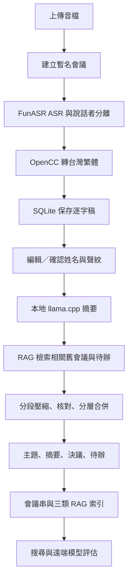

# Meeting Assistant

模組化的會議音訊整理系統：FunASR 語音辨識與說話者分離、OpenCC 台灣繁體中文正規化、本地 llama.cpp／GGUF 摘要、SQLite 記憶與 RAG、管理頁，以及遠端模型評估。

目前主機環境：

- Linux Raspberry Pi
- Python 3.10／Conda 環境 `py3_10`
- Qwen GGUF 本地模型
- Web 服務 `0.0.0.0:8080`
- user systemd 背景執行
- Nginx／HTTPS 網域 `meet.hyang.icu`（可選）

本文件以目前 `meeting_assistant/` 程式碼為準。`architecture/` 是設計與目前工作流文件；舊的 `config/`、`db/`、`extractors/`、`speech/` 目錄不是目前 Web 服務的執行依賴。

## 1. 工作流



重要行為：

- 上傳音檔只執行語音辨識，不會自動執行本地 LLM。
- 辨識完成後可編輯 speaker 0、1、2、3 等匿名說話者。
- 按「確認姓名」才會同步逐字稿並建立可跨會議使用的聲紋 profile。
- 摘要成功後，模型生成的主題會成為會議名稱；未完成前使用「整理中 · 日期時間」。
- 長逐字稿使用 tokenizer、checkpoint 與 map／verify／reduce／final 流程，避免一次讀完整段造成遺忘。
- 關閉或刷新網頁不會停止伺服器工作；服務重啟後，重新執行摘要可由 SQLite checkpoint 恢復已完成批次。

## 2. 必要檔案

### 執行所需的程式

```text
pyproject.toml
meeting_assistant/
├── __init__.py
├── cli.py                 # CLI 入口
├── web.py                 # HTTP API、背景工作與頁面
├── tools.py               # ASR、摘要、RAG、評估協調
├── audio.py               # 音訊切段
├── asr.py                 # FunASR、diarization、CAM++
├── normalize.py           # OpenCC s2twp
├── orchestrator.py        # llama.cpp 與分層摘要
├── rag.py                 # 本地 hashed n-gram 向量
├── speaker_identity.py    # 姓名線索與聲紋比對
├── db.py                  # SQLite schema、RAG、checkpoint
├── evaluation.py          # 遠端 Responses API 評估
├── logging.py             # 統一事件 log
├── models.py              # 資料模型
└── web/
    ├── index.html
    ├── app.js
    ├── app.css
    ├── admin.html
    ├── admin.js
    ├── admin.css
    ├── evaluation.html
    ├── evaluation.js
    └── evaluation.css
```

### 文件、部署與測試

```text
architecture/01-overview.md ... architecture/09-current-workflow.md
deploy/nginx-meeting-assistant.conf
tools/benchmark_llama_context_speed.py
tools/test_llama_context_limit.py
tools/test_speaker_identity.py
tools/test_summary_checkpoints.py
LICENSE.txt
README.md
```

### 執行時資料

第一次啟動會自動建立：

```text
data/meetings.sqlite3
data/uploads/
```

現有資料庫、上傳音檔、log、backup 與 GGUF 模型不是乾淨安裝所需的程式檔，且可能含有會議隱私。不要把 API key、會議資料、聲紋或 log 推送到公開儲存庫。

## 3. 系統需求與安裝

需要 Python 3.10 以上；目前 Raspberry Pi 使用：

```text
/home/cgu-csie/miniconda3/envs/py3_10/bin/python
```

建立環境：

```bash
conda create -n py3_10 python=3.10 -y
conda activate py3_10
```

Raspberry Pi 建議先安裝編譯與音訊套件：

```bash
sudo apt update
sudo apt install -y build-essential cmake ninja-build pkg-config libsndfile1 ffmpeg
```

安裝本專案及 ASR／LLM 依賴：

```bash
cd /home/cgu-csie/meet-demo
conda activate py3_10
python -m pip install --upgrade pip setuptools wheel
python -m pip install -e ".[asr,llm]"
```

`pyproject.toml` 定義：

- 基本依賴：`opencc-python-reimplemented`
- `asr` 額外依賴：`funasr`、`torch`、`torchaudio`
- `llm` 額外依賴：`llama-cpp-python`

ARM 主機若沒有相容的 PyTorch 或 llama-cpp-python wheel，需依套件對 ARM／Python 版本的安裝方式取得相容版本。首次使用 FunASR 可能下載 ASR、VAD、標點與 CAM++ 模型，因此需要網路。

驗證：

```bash
python - <<'PY'
import opencc, torch, torchaudio, funasr, llama_cpp
print("Python dependencies: OK")
PY
```

## 4. 模型與音訊配置

### llama.cpp GGUF

目前範例模型：

```text
/home/cgu-csie/qwen3-4b-instruct-2507-q8_0.gguf
```

正式啟動建議明確設定：

```bash
export LLAMA_CPP_MODEL=/home/cgu-csie/qwen3-4b-instruct-2507-q8_0.gguf
test -r "$LLAMA_CPP_MODEL"
```

沒有設定 `LLAMA_CPP_MODEL` 時，程式才會嘗試舊版 `MODEL_PATH`、`models/*.gguf` 或使用者目錄的 `*.gguf`。不同 GGUF 模型的 chat template、tokenizer 與中文 JSON 輸出品質可能不同，請使用 instruct 模型。

### FunASR

| 變數 | 預設值 | 用途 |
| --- | --- | --- |
| `FUNASR_MODEL` | `paraformer-zh` | ASR |
| `FUNASR_VAD_MODEL` | `fsmn-vad` | 語音活動偵測 |
| `FUNASR_PUNC_MODEL` | `ct-punc-c` | 標點 |
| `FUNASR_SPK_MODEL` | `cam++` | 說話者與聲紋 |
| `FUNASR_SPK_MATCH_THRESHOLD` | `0.74` | 聲紋門檻，0.50–0.99 |

音訊以 16 kHz、單聲道、PCM WAV 最穩定。非 WAV 會保留原檔交給 FunASR；請確認目前 FunASR／torchaudio 能解碼該格式。每位說話者需要約 1.5 秒以上有效語音才會建立 CAM++ embedding。聲紋不會上傳，且只有使用者確認姓名後才會成為跨會議 profile。

## 5. 所有環境變數

程式不會自動載入 dotenv。手動執行使用 `export`；systemd 使用 `EnvironmentFile`。目前 `.env.example` 是舊版 Flask 配置樣板，不是本專案的自動配置入口。

### 本地 LLM

| 變數 | 預設值 | 說明 |
| --- | ---: | --- |
| `LLAMA_CPP_MODEL` | 無 | GGUF 絕對路徑，建議必填 |
| `MODEL_PATH` | 無 | 舊版相容名稱 |
| `LLAMA_CPP_CONTEXT` | `16384` | context，安全範圍 8192–16384 |
| `LLAMA_CPP_THREADS` | CPU 核心數減一 | CPU 執行緒 |
| `LLAMA_CPP_GPU_LAYERS` | `0` | offload 層數，Pi 通常設 0 |
| `PYTHONUNBUFFERED` | 無 | 建議設 `1` 讓 log 即時輸出 |

### 摘要 token

管理頁保存的 SQLite `app_settings` 優先於下列環境變數；環境變數是初始預設值。

| 變數 | 預設值 | 限制 | 用途 |
| --- | ---: | ---: | --- |
| `LLAMA_CPP_DIRECT_MAX_TOKENS` | 2400 | 256–8192 | 直接摘要門檻 |
| `LLAMA_CPP_CHUNK_TOKENS` | 2200 | 256–8192 | 每段輸入目標 |
| `LLAMA_CPP_MAP_MAX_TOKENS` | 1024 | 512–8192 | 每段壓縮輸出 |
| `LLAMA_CPP_VERIFY_MAX_TOKENS` | 768 | 256–2048 | 重要段落核對 |
| `LLAMA_CPP_REDUCE_INPUT_TOKENS` | 4096 | 512–8192 | 合併輸入目標 |
| `LLAMA_CPP_REDUCE_MAX_TOKENS` | 2048 | 512–8192 | 合併輸出上限 |
| `LLAMA_CPP_MAX_TOKENS` | 3072 | 512–8192 | 最終摘要輸出 |

目前設定範例：

```bash
export LLAMA_CPP_MODEL=/home/cgu-csie/qwen3-4b-instruct-2507-q8_0.gguf
export LLAMA_CPP_CONTEXT=16384
export LLAMA_CPP_DIRECT_MAX_TOKENS=2400
export LLAMA_CPP_CHUNK_TOKENS=2200
export LLAMA_CPP_MAP_MAX_TOKENS=1024
export LLAMA_CPP_VERIFY_MAX_TOKENS=768
export LLAMA_CPP_REDUCE_INPUT_TOKENS=4096
export LLAMA_CPP_REDUCE_MAX_TOKENS=2048
export LLAMA_CPP_MAX_TOKENS=3072
export PYTHONUNBUFFERED=1
```

### 管理員與遠端評估

| 變數 | 預設值 | 用途 |
| --- | --- | --- |
| `MEETING_ADMIN_TOKEN` | 空 | 設定後管理 API 要求 `X-Admin-Token` |
| `CGULLM_API_KEY` | 空 | 遠端評估必填 |
| `CGULLM_BASE_URL` | `https://air.cgu.edu.tw/cgullmapi/v1` | OpenAI 相容 base URL |
| `CGULLM_MODEL` | `gpt-6-luna` | 遠端摘要／評審模型 |
| `CGULLM_TIMEOUT` | 180 | 遠端 timeout，秒 |

手動設定：

```bash
export MEETING_ADMIN_TOKEN='請換成長且隨機的 token'
export CGULLM_API_KEY='請填入 API key'
export CGULLM_BASE_URL='https://air.cgu.edu.tw/cgullmapi/v1'
export CGULLM_MODEL='gpt-6-luna'
export CGULLM_TIMEOUT=180
```

`.bashrc` 只影響互動式 shell；user systemd 不一定會載入它。正式服務請使用下面的 systemd `EnvironmentFile`。

## 6. 啟動與重啟

### 前景啟動

```bash
cd /home/cgu-csie/meet-demo
conda activate py3_10
export LLAMA_CPP_MODEL=/home/cgu-csie/qwen3-4b-instruct-2507-q8_0.gguf
export LLAMA_CPP_CONTEXT=16384
export PYTHONUNBUFFERED=1

/home/cgu-csie/miniconda3/envs/py3_10/bin/python -u \
  -m meeting_assistant.cli web \
  --host 0.0.0.0 --port 8080
```

健康檢查：

```bash
curl http://127.0.0.1:8080/health
```

預期回應：

```json
{"status": "ok"}
```

頁面：

```text
http://主機IP:8080/
http://主機IP:8080/admin
http://主機IP:8080/evaluate
```

### CLI 直接辨識

```bash
python -m meeting_assistant.cli transcribe /path/to/recording.wav
```

這個指令只做 ASR 與保存，不自動做本地 LLM 摘要。若指定資料庫，global option 放在子命令之前：

```bash
python -m meeting_assistant.cli --db data/meetings.sqlite3 transcribe /path/to/recording.wav
```

### 一次性 user systemd

```bash
cd /home/cgu-csie/meet-demo
systemctl --user stop meeting-assistant.service 2>/dev/null || true
systemd-run --user \
  --unit=meeting-assistant.service \
  --property=Restart=on-failure \
  --property=RestartSec=5s \
  --working-directory=/home/cgu-csie/meet-demo \
  --setenv=LLAMA_CPP_MODEL=/home/cgu-csie/qwen3-4b-instruct-2507-q8_0.gguf \
  --setenv=LLAMA_CPP_CONTEXT=16384 \
  --setenv=PYTHONUNBUFFERED=1 \
  /home/cgu-csie/miniconda3/envs/py3_10/bin/python -u \
  -m meeting_assistant.cli web --host 0.0.0.0 --port 8080
```

管理：

```bash
systemctl --user status meeting-assistant.service
systemctl --user restart meeting-assistant.service
systemctl --user stop meeting-assistant.service
```

### 永久 user systemd

建立環境檔 `/home/cgu-csie/.config/meeting-assistant.env`（放在專案外，避免 API key 進入 Git）：

```text
LLAMA_CPP_MODEL=/home/cgu-csie/qwen3-4b-instruct-2507-q8_0.gguf
LLAMA_CPP_CONTEXT=16384
LLAMA_CPP_DIRECT_MAX_TOKENS=2400
LLAMA_CPP_CHUNK_TOKENS=2200
LLAMA_CPP_MAP_MAX_TOKENS=1024
LLAMA_CPP_VERIFY_MAX_TOKENS=768
LLAMA_CPP_REDUCE_INPUT_TOKENS=4096
LLAMA_CPP_REDUCE_MAX_TOKENS=2048
LLAMA_CPP_MAX_TOKENS=3072
PYTHONUNBUFFERED=1
MEETING_ADMIN_TOKEN=replace-with-a-random-token
CGULLM_API_KEY=replace-with-api-key
CGULLM_BASE_URL=https://air.cgu.edu.tw/cgullmapi/v1
CGULLM_MODEL=gpt-6-luna
CGULLM_TIMEOUT=180
```

只需要本地功能時可移除 `CGULLM_API_KEY`。保護環境檔：

```bash
chmod 600 /home/cgu-csie/.config/meeting-assistant.env
```

建立 `/home/cgu-csie/.config/systemd/user/meeting-assistant.service`：

```ini
[Unit]
Description=Meeting Assistant Web Service
After=default.target

[Service]
Type=simple
WorkingDirectory=/home/cgu-csie/meet-demo
EnvironmentFile=/home/cgu-csie/.config/meeting-assistant.env
ExecStart=/home/cgu-csie/miniconda3/envs/py3_10/bin/python -u -m meeting_assistant.cli web --host 0.0.0.0 --port 8080
Restart=on-failure
RestartSec=5

[Install]
WantedBy=default.target
```

套用：

```bash
mkdir -p /home/cgu-csie/.config/systemd/user
systemctl --user daemon-reload
systemctl --user enable --now meeting-assistant.service
systemctl --user status meeting-assistant.service
```

需要登出後仍保持 user systemd 時，可啟用：

```bash
loginctl enable-linger cgu-csie
```

### nohup 備用

```bash
cd /home/cgu-csie/meet-demo
nohup env \
  LLAMA_CPP_MODEL=/home/cgu-csie/qwen3-4b-instruct-2507-q8_0.gguf \
  LLAMA_CPP_CONTEXT=16384 \
  PYTHONUNBUFFERED=1 \
  /home/cgu-csie/miniconda3/envs/py3_10/bin/python -u \
  -m meeting_assistant.cli web --host 0.0.0.0 --port 8080 \
  >> data/meeting-assistant-nohup.log 2>&1 < /dev/null &
```

若主機或終端會清理背景子程序，請使用 user systemd。

## 7. 網頁與摘要流程

1. 上傳音檔後建立「整理中 · 日期時間」記錄，時間取瀏覽器的 `started_at`；沒有日期線索時以此作會議時間。
2. FunASR 在背景辨識並保存原始文字、台灣繁體文字、時間戳與 speaker ID。
3. 使用者可編輯姓名；按「確認姓名」才會同步逐字稿並建立／更新聲紋 profile。
4. 按「產生摘要與追蹤」後才使用 llama.cpp。
5. 短稿直接分析；長稿先按 tokenizer 與發言切段。
6. 每段先做語意壓縮；含數字、日期、決議、待辦、期限、風險或未解問題時才做額外核對。
7. 分批合併並產生主題、摘要、決議、待辦與前次待辦完成度。
8. 成功產生主題後以主題命名，並建立會議串與 RAG 索引。
9. 輸出被截斷或 JSON 不合法時不保存半成品；已完成批次留在 `analysis_checkpoints`，重新執行可恢復。

原始逐字稿完整保存，摘要只保存壓縮後的重要資訊，不會用逐段 evidence 清單取代摘要。

## 8. RAG、資料庫與管理頁

預設資料庫：

```text
data/meetings.sqlite3
```

RAG 使用同一 SQLite 的三張表：

| 表 | 內容 |
| --- | --- |
| `rag_content` | 分段逐字稿 |
| `rag_summaries` | 會議摘要 |
| `rag_actions` | 待辦事項 |

索引以會議主題 `topic_key` 關聯 `meeting_id`。目前向量是 512 維 hashed n-gram，使用 cosine similarity；不需要額外 embedding 模型，但語意能力不等同神經網路 embedding。

重要資料表：

- `meetings`、`utterances`：會議與逐字稿。
- `speakers`、`speaker_profiles`：單場 speaker 與跨會議聲紋。
- `actions`、`decisions`、`follow_ups`：待辦、決議、前次追蹤。
- `logs`：處理紀錄。
- `evaluations`：遠端評估。
- `analysis_checkpoints`：長摘要恢復。
- `app_settings`：管理頁 context／token 設定。

管理頁 `/admin` 可查看資料統計、刪除單場會議、清除全部資料、調整 context（8192–16384）與所有摘要 token。token 設定下一次摘要生效；context 會背景重載模型；設定保存於 `app_settings`，重啟後仍保留。

管理 API 設定 `MEETING_ADMIN_TOKEN` 後，需要標頭：

```text
X-Admin-Token: 你的管理員 token
```

不要在公開服務留空管理 token。

備份：

```bash
systemctl --user stop meeting-assistant.service
sqlite3 /home/cgu-csie/meet-demo/data/meetings.sqlite3 \
  ".backup '/home/cgu-csie/meet-demo/data/meetings.sqlite3.backup'"
systemctl --user start meeting-assistant.service
```

## 9. API

| 用途 | 方法與路徑 |
| --- | --- |
| 健康檢查 | `GET /health` |
| 會議列表 | `GET /api/meetings` |
| 上傳／開始 ASR | `POST /api/transcribe` |
| ASR 狀態 | `GET /api/meetings/{id}/transcription-status` |
| 完整會議 | `GET /api/meetings/{id}` |
| 確認說話者 | `PUT /api/meetings/{id}/speakers` |
| 姓名推測 | `POST /api/meetings/{id}/speaker-suggestions` |
| 姓名狀態 | `GET /api/meetings/{id}/speaker-suggestions-status` |
| 開始摘要 | `POST /api/meetings/{id}/analyze` |
| 摘要狀態 | `GET /api/meetings/{id}/analysis-status` |
| RAG 搜尋 | `GET /api/search?q=關鍵字&type=all` |
| 評估歷史 | `GET /api/evaluations?meeting_id={id}` |
| 管理統計 | `GET /api/admin/stats` |
| 管理設定 | `GET/PUT /api/admin/config` |
| 刪除會議 | `DELETE /api/admin/meetings/{id}` |
| 清除資料 | `POST /api/admin/purge` |

## 10. 遠端模型評估

先完成一次本地 llama.cpp 摘要，再開啟 `/evaluate`。評估頁不會重新執行本地模型，而是呼叫：

- Base URL：`https://air.cgu.edu.tw/cgullmapi/v1`
- Model：`gpt-6-luna`
- Endpoint：由程式追加 `/responses`

設定：

```bash
export CGULLM_API_KEY='請填入 API key'
export CGULLM_BASE_URL='https://air.cgu.edu.tw/cgullmapi/v1'
export CGULLM_MODEL='gpt-6-luna'
```

評估結果保存於 `evaluations`；分數是模型估計，不等同人工標註的客觀正確率。

## 11. Log、Nginx 與 HTTPS

### Log

systemd 服務：

```bash
journalctl --user -u meeting-assistant.service -n 100 -f -o cat
systemctl --user status meeting-assistant.service
```

只用 `-f` 時可能只等待新事件；加 `-n 100` 可先顯示歷史。模型 token 即時輸出主要在網頁「模型即時輸出」，journal 只記錄階段、錯誤與完成事件。每場會議的 log 也保存於 SQLite `logs`。

`data/meeting-assistant-nohup.log` 只有在使用 nohup 並重新導向時才是目前輸出；systemd 執行時以 journal 為準。

### Nginx

DNS 的 `A`／`AAAA` 必須指向主機，公網需可連 TCP 80／443，且 `meet.hyang.icu` 只能有一組 Nginx server block。專案設定：

```text
deploy/nginx-meeting-assistant.conf
```

安裝：

```bash
sudo grep -R -n "server_name meet.hyang.icu" \
  /etc/nginx/sites-enabled /etc/nginx/conf.d

sudo cp /home/cgu-csie/meet-demo/deploy/nginx-meeting-assistant.conf \
  /etc/nginx/sites-available/meet-hyang-icu
sudo ln -s /etc/nginx/sites-available/meet-hyang-icu \
  /etc/nginx/sites-enabled/meet-hyang-icu
sudo nginx -t
sudo systemctl reload nginx
```

設定檔預期憑證：

```text
/etc/letsencrypt/live/meet.hyang.icu/fullchain.pem
/etc/letsencrypt/live/meet.hyang.icu/privkey.pem
```

尚未有憑證且 DNS 已生效時：

```bash
sudo certbot --nginx -d meet.hyang.icu
```

502 檢查：

```bash
curl http://127.0.0.1:8080/health
systemctl --user status meeting-assistant.service
sudo nginx -t
sudo journalctl -u nginx -n 100 --no-pager
```

### 服務更新

```bash
cd /home/cgu-csie/meet-demo
conda activate py3_10
python -m pip install -e ".[asr,llm]"
systemctl --user restart meeting-assistant.service
curl http://127.0.0.1:8080/health
```

修改 Python 或環境變數後必須重啟；只修改 Web 靜態檔時重新整理瀏覽器即可。

## 12. 測試與常見問題

測試：

```bash
python -m compileall meeting_assistant tools
python -m unittest tools.test_speaker_identity tools.test_summary_checkpoints
git diff --check
```

常見問題：

- `找不到 GGUF`：確認 `LLAMA_CPP_MODEL` 是服務實際取得的環境變數，且檔案可讀。
- `沒有 llama_cpp`：在 `py3_10` 執行 `python -m pip install -e ".[llm]"`。
- `沒有 FunASR`：在 `py3_10` 執行 `python -m pip install -e ".[asr]"`。
- `Address already in use`：先用 `sudo lsof -nP -iTCP:8080 -sTCP:LISTEN` 找出服務，不要同時啟動第二個 Web。
- 摘要超出 token：到 `/admin` 降低 `reduce_input_tokens`／`reduce_max_tokens` 或 `chunk_tokens`，並重新執行摘要。
- 姓名永遠是空白：模型只根據明確的自我介紹／稱呼線索，不會依 speaker ID 猜姓名；必須先確認一次姓名，聲紋才有可套用的 profile。

架構文件：

- [系統總覽](architecture/01-overview.md)
- [音訊擷取](architecture/02-audio-ingest.md)
- [ASR 與 diarization](architecture/03-asr-diarization.md)
- [資料庫與記憶](architecture/04-memory-db.md)
- [LLM 編排](architecture/05-llm-orchestrator.md)
- [工具層](architecture/06-tools.md)
- [Log 層](architecture/07-logging.md)
- [UI 與部署](architecture/08-ui-deployment.md)
- [目前工作流](architecture/09-current-workflow.md)
