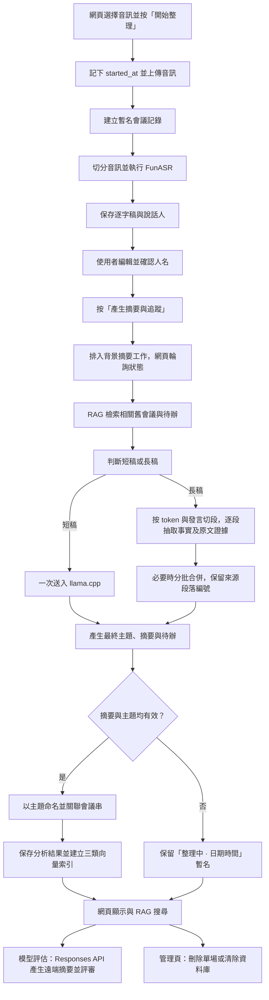

# Meeting Assistant 目前工作流

本文依目前程式實作整理，描述網頁會議記錄從音訊上傳到檢索、模型評估與管理的流程。

## 一眼看懂



## 會議建立與語音辨識

1. 使用者選擇音訊檔並按「開始整理」。瀏覽器記錄當下時間為 ISO `started_at`，以 multipart 表單送到 `POST /api/transcribe`。
2. 後端將音訊存至 `data/uploads/`，建立 UUID 會議記錄。初始標題為「整理中 · YYYY-MM-DD HH:mm」；`created_at` 與 `meeting_time` 先使用這次開始時間。HTTP 請求在音檔寫入並排入背景工作後立即回應，不等待模型載入。
3. `AudioIngest` 將音訊切成片段，FunASR adapter 在背景辨識逐字稿與說話人；辨識文字及繁體化文字一起保存至 SQLite。網頁輪詢 `/api/meetings/{id}/transcription-status` 顯示模型載入、辨識進度與錯誤，辨識完成前不能啟動姓名推測或摘要。
4. 網頁顯示逐字稿與說話人。使用者可編輯姓名，按「確認人名」呼叫 `PUT /api/meetings/{meeting_id}/speakers`；逐字稿顯示時會以確認後的姓名取代 speaker ID。

語音辨識與 LLM 分成兩個操作：上傳完成只建立逐字稿，不會自動開始 llama.cpp 分析。

## 摘要、會議日期與自動命名

使用者按「產生摘要與追蹤」後，網頁呼叫 `POST /api/meetings/{meeting_id}/analyze`：

1. 後端讀取逐字稿與 RAG 找到的相關舊會議。短輸入（完整 prompt 預設不超過 2400 tokens）沿用單次摘要；較長輸入採分層摘要。
2. 分層摘要先使用實際 GGUF tokenizer，按發言切成目標約 1800 tokens 的片段；單一過長發言會再拆小，並保留說話人與時間。每段分別抽取主題線索、事實、原文證據、決議、待辦及可能的本場會議時間。
3. 如果各段的抽取結果加上舊會議資料仍超出模型上下文，就按 token 預算分批合併，必要時重複合併；合併紀錄會帶著來源段落編號，再交給 llama.cpp 產生最終摘要。逐段、合併、最終輸出都有獨立階段 log。
4. 每個 prompt 都會依模型 tokenizer 計算長度，並為生成輸出與 prompt 格式保留上下文安全空間。逐段抽取與每個合併批次都會以 SQLite 檢查點持久化；服務中斷後再次啟動同場分析時，會驗證逐字稿、模型與 prompt 是否相符，沿用完整檢查點，只重做未完成工作。合併輸出達 token 上限時會遞迴拆小批次重試；單批仍失敗時保留先前成功的檢查點，不把不完整結果保存成正式摘要。
5. 最終輸出包含會議主題、摘要、待辦、決議，以及可能的會議日期時間。
6. 如果逐字稿明確提到本場會議日期或時間，模型應回傳 ISO 格式；否則使用建立記錄時保存的 `started_at`。無法解析的日期也會退回開始時間。
7. 摘要與主題都有效時，以主題更新會議名稱。若摘要或主題未成功產生，則保留「整理中 · 日期時間」暫名；模型呼叫失敗時網頁會收到錯誤，不會以錯誤結果覆蓋既有會議記錄。
8. 新主題會作為 topic key，並連結符合條件的舊會議。多場相關會議共用一個 thread；有多場會議時，模型可為會議串提供合併後的主軸名稱。
9. 保存摘要、待辦、決議與前次待辦追蹤結果，成功完成摘要後再建立三類 RAG 索引。

摘要工作在伺服器背景執行，`POST .../analyze` 會快速回覆工作狀態；網頁以 `GET /api/meetings/{id}/analysis-status` 輪詢階段與結果，避免長時間推理佔住 Nginx／Cloudflare 的單一 HTTP 請求。分頁關閉不會終止伺服器工作；若服務重啟，工作執行緒會停止，但重新對同一場會議按「產生摘要」即可從 SQLite 檢查點恢復。成功保存正式摘要後會清除檢查點；刪除會議或清空資料也會一併清除。

主要可調參數：`LLAMA_CPP_CONTEXT`（預設 16384）、`LLAMA_CPP_DIRECT_MAX_TOKENS`（2400）、`LLAMA_CPP_CHUNK_TOKENS`（1800）、`LLAMA_CPP_MAP_MAX_TOKENS`（3072）、`LLAMA_CPP_REDUCE_INPUT_TOKENS`（4096）、`LLAMA_CPP_REDUCE_MAX_TOKENS`（4096）、`LLAMA_CPP_MAX_TOKENS`（4096）。管理頁可調整直接摘要門檻、逐段輸入與輸出、合併輸入與輸出、最終輸出上限；token 預算變更保存於 `app_settings`，下一次分析生效。合併輸入目標預設不超過目前 context 的三分之一；實際輸出上限仍會依 context 與安全預留量檢查。若使用其他記憶體配置，應依實測調整 context，且不可超過模型實際支援範圍。

管理頁可調整 8192–16384 的 llama.cpp context，設定保存於 `app_settings`，不會隨會議資料清除操作刪除。已載入模型會在背景卸載並以新 context 重載；若摘要正在進行，設定工作會等待摘要完成，期間不接受新的摘要工作。模型載入失敗時會嘗試恢復原 context，且不保存失敗的新設定。管理頁已保存的設定優先於 `LLAMA_CPP_CONTEXT` 環境變數；沒有管理頁設定時才使用環境變數或程式預設。

## RAG 檢索與前次待辦追蹤

RAG 資料目前存放於同一個 SQLite 資料庫的三張表中，並非三個獨立資料庫：

| 資料表 | 索引內容 | 用途 |
| --- | --- | --- |
| `rag_content` | 分段逐字稿 | 檢索會議內文 |
| `rag_summaries` | 會議摘要 | 檢索摘要 |
| `rag_actions` | 待辦事項 | 檢索待辦與期限、負責人 |

索引以生成的會議主題作為 `topic_key`，並保留對應 `meeting_id`。目前向量為無外部依賴的 512 維 hashed n-gram，搜尋以 cosine 相似度排序；它是輕量本機檢索，不等同於神經網路 embedding。

產生新摘要前，系統會用本次逐字稿檢索舊會議摘要、內文與待辦，將候選會議及其待辦交給本地模型。模型只應評估檢索資料中確實相關的舊會議，並把待辦標記為已完成、進行中或本次未提及，附上簡短結論。未明確關聯的候選不會自動加入會議串。

首頁提供「所有記憶、會議內文、會議總結、待辦事項」檢索選項。資料庫啟動時也會替有既有摘要、但尚未建立索引的舊會議補建 RAG 索引。

## 會議頁面與 API

| 用途 | 路徑 | 方法 |
| --- | --- | --- |
| 首頁與會議列表 | `/`、`/api/meetings` | GET |
| 上傳音訊與辨識 | `/api/transcribe` | POST |
| 查詢語音辨識工作狀態 | `/api/meetings/{id}/transcription-status` | GET |
| 確認說話人姓名 | `/api/meetings/{id}/speakers` | PUT |
| 啟動背景摘要與追蹤 | `/api/meetings/{id}/analyze` | POST |
| 查詢摘要工作狀態 | `/api/meetings/{id}/analysis-status` | GET |
| 讀取完整會議記錄 | `/api/meetings/{id}` | GET |
| 搜尋 RAG 記憶 | `/api/search?q=...&type=content\|summary\|action\|all` | GET |
| 健康檢查 | `/health` | GET |

完整會議記錄頁會顯示會議名稱與日期、摘要、說話人、逐字稿、待辦、決議、前次待辦追蹤、所屬會議串及處理記錄。資料預設存於 `data/meetings.sqlite3`，上傳音訊存於 `data/uploads/`。

## 遠端模型評估

1. 先在會議頁完成一次本地 llama.cpp 摘要；評估頁不會重新執行本地模型。
2. 開啟 `/evaluate` 並選擇會議，按評估按鈕後呼叫 `POST /api/evaluations`。
3. 遠端 Responses API（預設 `gpt-6-luna`）產生另一份摘要；評審模型以原始逐字稿為準，匿名比較兩份結果的事實正確性、涵蓋度及待辦／決議準確性。
4. 評估結果保存於 `evaluations`，可於頁面查看歷史結果。評分是模型估計，不能視為人工標註的客觀正確率。

這個長逐字稿 map/reduce 流程目前用於本地 llama.cpp 摘要；評估頁的遠端 Responses API 仍以原逐字稿進行遠端摘要及評審，不會重跑本地模型。

設定使用 `CGULLM_API_KEY`、`CGULLM_BASE_URL` 與 `CGULLM_MODEL` 環境變數。API key 只由後端讀取。

## 管理與部署

- 管理頁：`/admin`。可查看資料統計、刪除單場會議及相關索引，或清除全部資料。
- 若設定 `MEETING_ADMIN_TOKEN`，管理變更需透過 `X-Admin-Token` 驗證；未設定時不會要求 token。
- Web server 預設監聽 `0.0.0.0:8080`。在本機或區網可用主機 IP 加上 `:8080` 開啟；Nginx 可將 `meet.hyang.icu` 反向代理至本機 8080。
- 目前以 Python 3.10 環境在背景啟動時，可使用：

  ```bash
  cd ~/meet-demo
  nohup /home/cgu-csie/miniconda3/envs/py3_10/bin/python -m meeting_assistant.cli web --host 0.0.0.0 --port 8080 >> nohup.out 2>&1 < /dev/null &
  ```

  日誌會追加至 `nohup.out`；啟動後可查看 `/health` 確認服務狀態。
